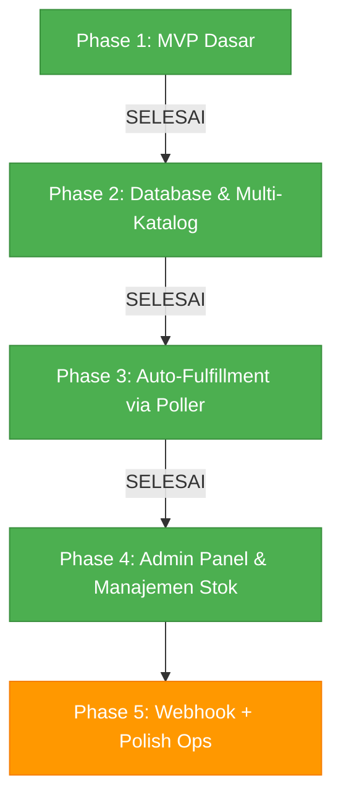

# Progress & Roadmap Bot Auto-Order (SayaBayar)

Dokumen ini mencatat status pengembangan bot Telegram auto-order, analisis fitur yang sudah selesai, kekurangan/gap sistem saat ini, serta rencana pengembangan selanjutnya.

---

## 📊 Status Ringkas (Executive Summary)

- **Status Saat Ini:** `Phase 4 (Systemd Service + Neobrutalism UI Dashboard)` — **Aktif Berjalan**
- **Framework:** Python 3.11, aiogram 3.12.0, FastAPI, Uvicorn, aiohttp 3.9.5, aiosqlite 0.22.1
- **Service Linux:** `bot-autoorder.service` (systemd, enabled & active)
- **Channel Target Force-Sub:** `@reveuseress`
- **Gateway Pembayaran:** SayaBayar API

**Update terakhir (2 Sep 2026):**
- ✅ **Peningkatan UX Komprehensif (ArchitectUX):**
  - Sapaan nama user dinamis & personal (`html.escape(first_name)`) pada onboarding `/start` dan verifikasi channel.
  - Kunci order saat stok 0: tombol otomatis berubah menjadi `❌ Stok Habis (Sedang Kosong)` dengan alert popup ramah dan proteksi server-side cegah invoice kosong.
  - Transparansi checkout: estimasi masa aktif invoice 15 menit & kejelasan auto-delivery < 15 detik untuk mencegah spam tombol cek status.
  - Purna jual & delivery message: panduan penggunaan akun, peringatan device, dan info garansi.
  - Pusat bantuan (`ℹ️ Bantuan`) komprehensif berisi panduan belanja 5 langkah.
  - Tombol pintas `[🤖 Buka Bot]` di topbar Web Dashboard Neobrutalism.
- ✅ **Systemd Service:** Dikonfigurasi sebagai service sistem `bot-autoorder.service` (auto-restart saat crash + auto-start saat reboot VPS).
- ✅ **Redesign Neobrutalism UI:** Tampilan admin dashboard di-redesign menyeluruh dengan gaya Neobrutalism (Space Grotesk, chunky 3D shadows, tactile buttons, high-contrast palette).
- ✅ Panel admin lengkap (`/admin`): tambah stok massal, cek stok, rekap penjualan, kelola & aktif/nonaktif produk, broadcast.
- ✅ Katalog dinamis multi-produk: pilih kategori → daftar produk (dengan sisa stok) → slide detail → checkout. Tidak ada lagi hardcode 1 produk.

---

## ✅ 1. Fitur yang Sudah Selesai (Completed)

| Fitur | Deskripsi | File Terkait |
| :--- | :--- | :--- |
| **Auto-Fulfillment & Auto-Delivery** | Klaim stok otomatis dan pengiriman akun instan via Telegram saat pembayaran lunas (PAID). Notifikasi out-of-stock ke user & alert admin. | [`fulfillment.py`](bot/services/fulfillment.py) |
| **Background Payment Poller** | Worker asynchronous yang berjalan di background mengecek status invoice PENDING tiap 15s dan otomatis memicu delivery. | [`poller.py`](bot/services/poller.py) |
| **Database SQLite (aiosqlite)** | Skema database async untuk users, categories, products, stocks, dan orders beserta helper CRUD dan auto-seeding. | [`db.py`](bot/database/db.py), [`crud.py`](bot/database/crud.py) |
| **Force Subscribe Channel** | Verifikasi keanggotaan user di channel `@reveuseress` sebelum mengakses menu. Tombol *Join Channel* & *Sudah Join*. | [`forcesub.py`](bot/utils/forcesub.py), [`callbacks.py`](bot/handlers/callbacks.py) |
| **Integrasi API SayaBayar** | Async HTTP Client untuk membuat invoice (`POST /invoices/create`), cek status (`GET /invoices/{id}`), dan cancel invoice. | [`sayabayar.py`](bot/utils/sayabayar.py) |
| **Katalog Dinamis Multi-Produk** 🆕 | Navigasi: Kategori → Daftar produk (harga + sisa stok, ikon ✅/❌) → Slide detail (deskripsi+stok → harga → beli). Semua produk aktif dari DB, bukan hardcode. | [`catalog.py`](bot/handlers/catalog.py) |
| **Panel Admin** 🆕 | `/admin` (khusus ADMIN_IDS): tambah stok massal 1-akun-per-baris via FSM, cek sisa stok per produk, rekap penjualan (omzet, transaksi sukses, produk terlaris), tambah produk baru via FSM, aktif/nonaktif produk, broadcast ke semua user. | [`admin.py`](bot/handlers/admin.py) |
| **Rekap Penjualan (CRUD)** 🆕 | `get_sales_stats()`: total omzet, transaksi COMPLETED/PENDING/PAID_OUT_OF_STOCK, top-5 produk terlaris, total stok ready. Plus `toggle_product_active()`. | [`crud.py`](bot/database/crud.py) |
| **Flow Checkout & Order DB** | Pembuatan invoice SayaBayar dan pencatatan order otomatis ke tabel `orders` SQLite. Tombol QRIS + cek status. | [`order.py`](bot/handlers/order.py) |
| **Pengecekan Status Manual** | Menu input ID invoice untuk memeriksa status pembayaran & sync status ke database SQLite. | [`order.py`](bot/handlers/order.py) |
| **Menu Navigasi Reply** | Keyboard navigasi utama (*🛒 Katalog Produk*, *💰 Cek Status*, *ℹ️ Bantuan*). | [`common.py`](bot/handlers/common.py) |

---

## 🧪 2. Verifikasi (2 Sep 2026)

Semua dijalankan dengan `venv/bin/python`, hasil **lulus semua**:

- Import seluruh modul + router (`main`) → OK
- `init_db()` + seeding → OK
- `get_sales_stats()` pada DB kosong → OK
- `toggle_product_active()` toggle bolak-balik → OK
- `add_stocks_bulk()` (baris kosong di-skip) + `get_stock_count()` → OK
- `get_all_products()` / `get_categories()` / `upsert_user()` / `get_user()` → OK
- Data hasil test sudah dibersihkan dari `database.sqlite3` (users=0, stocks=0)

> ⚠️ Catatan: uji end-to-end (beli sungguhan via SayaBayar) belum dilakukan karena butuh API key & pembayaran nyata.

---

## ⚠️ 3. Hal-Hal yang Masih Kurang (Identified Gaps & Missing Features)

### A. Operasional & Polish
- [ ] **Webhook SayaBayar**: fulfillment saat ini murni andalan poller 15s + cek manual. Webhook akan mempercepat delivery (opsional, poller sudah cukup untuk skala kecil).
- [x] **Edit/hapus produk** via admin dashboard (modal edit produk + inline rename kategori).
- [x] **Edit data stok** via admin dashboard (modal edit stok untuk ubah kredensial akun / relasi produk pada stok belum terjual).
- [x] **Manajemen kategori** via admin (tambah/rename/hapus kategori terintegrasi).
- [x] **Restock & kirim manual untuk order `PAID_OUT_OF_STOCK`**: fitur kirim akun manual (dari stok ready atau input baru) via dashboard.
- [ ] **Timeout invoice PENDING**: invoice yang tidak pernah dibayar tetap di-poll selamanya (max_age_hours di `get_pending_orders` belum dipakai).

### B. Keamanan & Robustness
- [ ] Rate-limit sederhana untuk cek status (anti-spam input invoice).
- [ ] Backup otomatis `database.sqlite3`.
- [ ] Logging ke file (saat ini stdout saja).

---

## 🗺️ 4. Roadmap Pengembangan (Next Steps)



### Tahap 5 (berikutnya, prioritas berurutan):
1. **Restock & kirim manual untuk `PAID_OUT_OF_STOCK`** — tombol admin untuk mengirim akun dan menuntaskan order.
2. **Edit produk via admin** — ubah harga/deskripsi tanpa sentuh DB.
3. **Webhook SayaBayar** — endpoint aiohttp menerima callback PAID (opsional, percepat delivery).
4. **Auto-expire invoice PENDING** — hentikan polling invoice tua.
5. **Backup DB harian + logging ke file.**

---

## 🌐 5. Web Admin Dashboard (Baru — 2 Sep 2026)

Dashboard FastAPI + Jinja2 + Tailwind (CDN) + Alpine.js + Chart.js. **Tanpa Node.js**.

### Fitur
| Modul | Isi |
| :--- | :--- |
| **Dashboard** | Metric cards (omzet, sukses/pending, stok ready, status bot), grafik penjualan 14 hari (Chart.js), top-5 produk, alert order butuh perhatian, activity log, tombol backup DB |
| **Stok** | Ringkasan stok berwarna (hijau/kuning/merah), bulk restock (1 akun/baris, auto-dedup), audit list (data tersamar, show/hide), hapus stok belum terjual, export .txt/.csv |
| **Produk** | CRUD produk lengkap (modal edit), toggle aktif/nonaktif (langsung ubah katalog bot), kelola kategori (tambah/rename/hapus dengan validasi relasi) |
| **Pesanan** | Monitor dengan filter status + pencarian, **Sync SayaBayar** (dengan verifikasi nominal → AMOUNT_MISMATCH), **Kirim Akun Manual** untuk PAID_OUT_OF_STOCK (pilih stok ready ATAU input manual — langsung kirim via bot ke pembeli), force cancel + hapus invoice gateway |
| **Users** | Daftar user + LTV (total belanja, jumlah order), **Broadcast engine**: preview HTML, tombol inline custom, target semua/pembeli, rekap terkirim/gagal |
| **Settings** | Health monitor (status bot, API key, aktivitas), backup DB satu klik |

### Keamanan
- Login password (session cookie HMAC-signed, HttpOnly, SameSite=lax, TTL 12 jam)
- CSRF token di semua form/POST API (header `x-csrf-token`)
- Brute-force guard: max 5 percobaan gagal / 5 menit per IP
- Semua endpoint terlindungi; secret key auto-generate ke `.web_secret`

### Jalankan
```bash
# Mode terintegrasi (bot + dashboard 1 proses) — default
python3 main.py

# Dashboard saja (bot jalan terpisah)
uvicorn web.app:app --host 127.0.0.1 --port 8800
```

Konfigurasi `.env`:
```
WEB_ENABLED=1          # 0 = matikan dashboard
WEB_HOST=127.0.0.1     # ganti 0.0.0.0 jika diakses dari luar (WAJIB pakai reverse proxy + HTTPS)
WEB_PORT=8800
WEB_ADMIN_PASSWORD=ganti-ini!
WEB_SECRET=            # kosong = auto-generate ke .web_secret
```

**PENTING:** password default `admin123` — dashboard menampilkan peringatan merah selama belum diganti.

### Integrasi Bot
`web/bot_bridge.py` menyimpan singleton Bot instance. Saat dashboard jalan dalam proses bot (`main.py`), bot didaftarkan via `set_bot()` — kirim akun manual & broadcast langsung memakai instance yang sama. Saat standalone, bridge membuat Bot kirim-saja (tanpa polling) sehingga aman berdampingan.

### Peningkatan Gateway (ikut di rilis ini)
- **Verifikasi nominal**: fulfillment menolak pembayaran yang nominalnya ≠ harga order (status `AMOUNT_MISMATCH`) — menutup lubang underpayment.
- **Auto-expire**: poller hanya memeriksa invoice PENDING ≤ 24 jam (`get_pending_orders`).
- Kontrak SayaBayar terverifikasi live (X-API-Key, POST /v1/invoices, DELETE cancel).

---

## 🚀 Cara Menjalankan

```bash
cd ~/bot_autoorder
source venv/bin/activate
python3 main.py
```

Menu admin: kirim `/admin` dari akun Telegram yang terdaftar di `ADMIN_IDS` (.env).
Tambah stok: `/admin` → 📦 Tambah Stok → pilih produk → kirim daftar akun (1 akun per baris).
